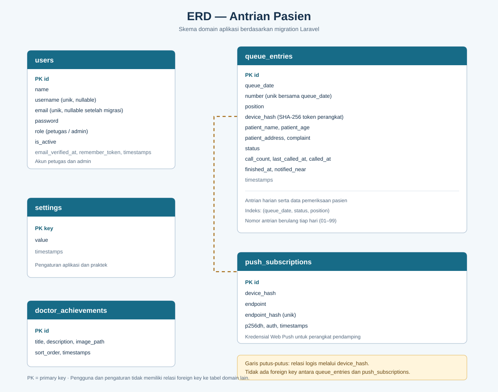

<p align="center"><a href="https://laravel.com" target="_blank"></a></p>

<p align="center">
<a href="https://github.com/laravel/framework/actions"></a>
<a href="https://packagist.org/packages/laravel/framework"></a>
<a href="https://packagist.org/packages/laravel/framework"></a>
<a href="https://packagist.org/packages/laravel/framework"></a>
</p>

## ERD Antrian Pasien

Diagram berikut menggambarkan tabel domain aplikasi berdasarkan migration:



## Setup Database

Atur koneksi database di `.env` dan pastikan `APP_TIMEZONE=Asia/Jakarta`, lalu jalankan migration dan seeder:

```bash
php artisan migrate --seed
```

Seeder membuat akun admin awal dengan username `admin` dan pengaturan default. Untuk menentukan password sendiri, isi `ADMIN_PASSWORD` di `.env` sebelum menjalankan seeder. Jika kosong, password acak ditampilkan satu kali di output terminal. Seeder tidak mengganti password admin yang sudah ada.

## Autentikasi API

Petugas dan admin masuk melalui `POST /api/auth/login` dengan `username` dan `password`. Respons berisi token Sanctum yang berlaku 12 jam; sertakan token pada endpoint terlindungi dengan header `Authorization: Bearer <token>`. Gunakan `GET /api/auth/me` untuk identitas sesi dan `POST /api/auth/logout` untuk mencabut token saat ini. Akses endpoint petugas dan admin dibatasi berdasarkan role akun.

## Landing dan Pendaftaran Pendamping

Landing page tersedia di `/` dengan gaya visual mengikuti dashboard Laravel Breeze. Halaman ini berisi form pendaftaran nama, usia, alamat, dan keterangan sakit; status atau nomor pasien yang sudah terdaftar tidak ditampilkan di sini. Token perangkat pendamping disimpan di `localStorage` browser untuk memulihkan status antrean pada halaman `/antrian`. Satu browser dapat mendaftarkan beberapa pasien; setiap pendaftaran membuat entri antrean terpisah yang terlihat petugas di dashboard. Endpoint pendamping hanya mengembalikan nomor dan status antrean, bukan data pasien. Form ditutup saat praktek tutup atau antrian harian penuh.

Landing page menyediakan pemasangan PWA. Setelah berhasil mendaftar, browser menuju `/antrian` untuk melihat nomor pasien, nomor yang sedang dipanggil, jumlah antrean di depan, dan status terkini. Halaman status tidak menampilkan data pribadi pasien, diperbarui otomatis setiap 10 detik, dan menyediakan notifikasi Web Push serta dialog saat giliran tiba. Tekan **Aktifkan notifikasi giliran** di halaman tersebut dan izinkan notifikasi pada browser. Push memerlukan HTTPS (localhost dapat digunakan untuk pengembangan) dan konfigurasi VAPID. Buat key pair dengan `php artisan push:vapid`, lalu isi `VAPID_PUBLIC_KEY`, `VAPID_PRIVATE_KEY`, dan `VAPID_SUBJECT` pada `.env`; jangan bagikan atau commit private key. Untuk produksi, gunakan domain HTTPS.

## Dashboard Petugas

Dashboard antrian tersedia di `/dashboard` setelah login Breeze menggunakan akun aktif ber-role petugas/admin. Dashboard ini memakai sesi web yang sudah login untuk mengakses API Sanctum stateful, jadi tidak meminta login API kedua atau membuat token baru. Dashboard Breeze mempertahankan navigasi dan logout bawaan. `/petugas` tetap tersedia sebagai halaman mandiri dengan login API berbasis token. Keduanya mendukung buka/tutup praktek, panggil, selesai, lewati, batalkan, dan geser antrian; daftar diperbarui otomatis setiap lima detik.

Jalankan Laravel Scheduler pada server agar pasien yang telah dipanggil tiga kali dapat digeser otomatis setelah dua menit dan antrian kemarin direset:

```bash
php artisan schedule:work
```

## About Laravel

Laravel is a web application framework with expressive, elegant syntax. We believe development must be an enjoyable and creative experience to be truly fulfilling. Laravel takes the pain out of development by easing common tasks used in many web projects, such as:

- [Simple, fast routing engine](https://laravel.com/docs/routing).
- [Powerful dependency injection container](https://laravel.com/docs/container).
- Multiple back-ends for [session](https://laravel.com/docs/session) and [cache](https://laravel.com/docs/cache) storage.
- Expressive, intuitive [database ORM](https://laravel.com/docs/eloquent).
- Database agnostic [schema migrations](https://laravel.com/docs/migrations).
- [Robust background job processing](https://laravel.com/docs/queues).
- [Real-time event broadcasting](https://laravel.com/docs/broadcasting).

Laravel is accessible, powerful, and provides tools required for large, robust applications.

## Learning Laravel

Laravel has the most extensive and thorough [documentation](https://laravel.com/docs) and video tutorial library of all modern web application frameworks, making it a breeze to get started with the framework.

In addition, [Laracasts](https://laracasts.com) contains thousands of video tutorials on a range of topics including Laravel, modern PHP, unit testing, and JavaScript. Boost your skills by digging into our comprehensive video library.

You can also watch bite-sized lessons with real-world projects on [Laravel Learn](https://laravel.com/learn), where you will be guided through building a Laravel application from scratch while learning PHP fundamentals.

## Agentic Development

Laravel's predictable structure and conventions make it ideal for AI coding agents like Claude Code, Cursor, and GitHub Copilot. Install [Laravel Boost](https://laravel.com/docs/ai) to supercharge your AI workflow:

```bash
composer require laravel/boost --dev

php artisan boost:install
```

Boost provides your agent 15+ tools and skills that help agents build Laravel applications while following best practices.

## Contributing

Thank you for considering contributing to the Laravel framework! The contribution guide can be found in the [Laravel documentation](https://laravel.com/docs/contributions).

## Code of Conduct

In order to ensure that the Laravel community is welcoming to all, please review and abide by the [Code of Conduct](https://laravel.com/docs/contributions#code-of-conduct).

## Security Vulnerabilities

If you discover a security vulnerability within Laravel, please send an e-mail to Taylor Otwell via [taylor@laravel.com](mailto:taylor@laravel.com). All security vulnerabilities will be promptly addressed.

## License

The Laravel framework is open-sourced software licensed under the [MIT license](https://opensource.org/licenses/MIT).
